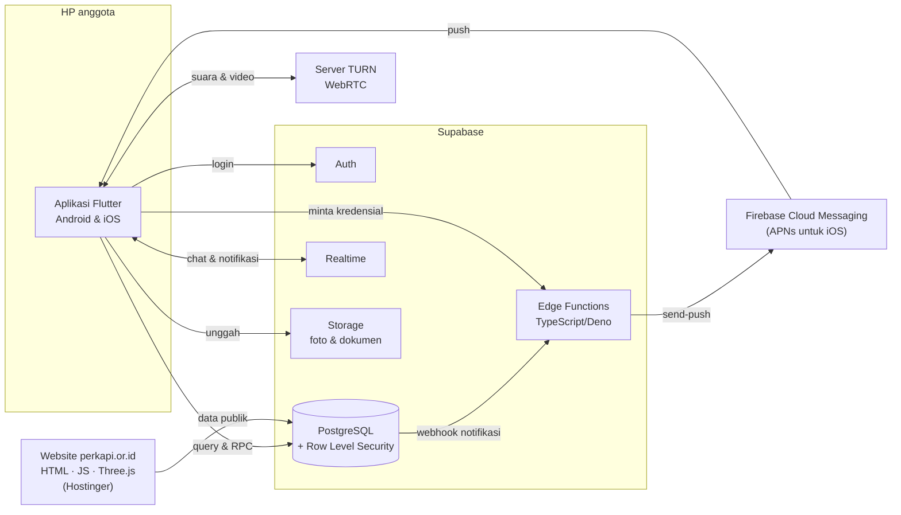
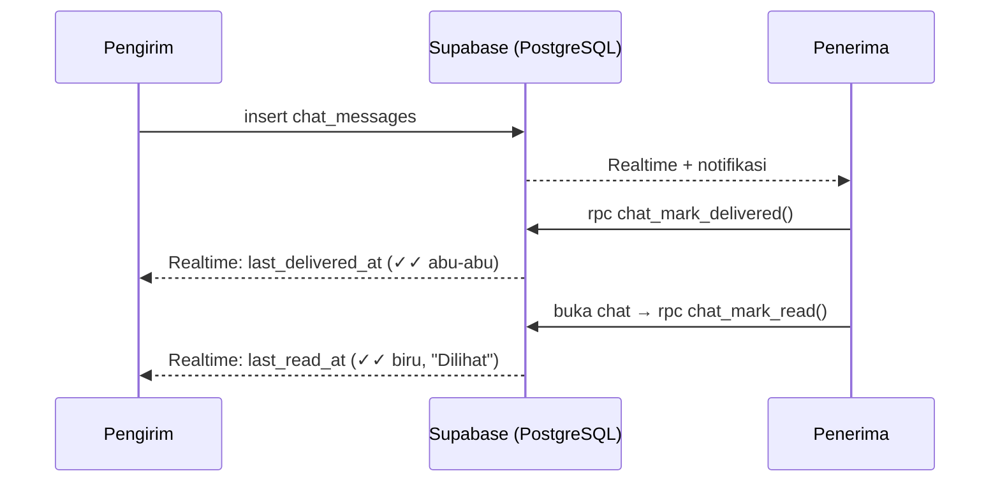

# Arsitektur

[← Kembali ke ringkasan](README.md)

## Gambaran sistem



## Struktur kode aplikasi

Kode diatur per fitur (*feature-first*):

```
lib/
├── app/          # router (go_router), tema, controller tema
├── core/         # konstanta, layanan (Supabase, push, PIN), utilitas, widget bersama (Liquid Glass)
├── features/     # 31 modul: auth, chat, members, documents, cases, donations, ...
└── shared/       # model & repository data bersama
```

## Alur status pesan (✓ / ✓✓ / ✓✓ biru)



## Alur notifikasi

1. Aplikasi menyimpan token FCM perangkat ke tabel `device_tokens`.
2. Saat ada baris baru di tabel `notifications`, database webhook memanggil Edge Function `send-push`.
3. `send-push` membuat token akses Google dari service account, lalu mengirim pesan ke FCM per perangkat.
4. Panggilan ke Android dikirim sebagai pesan data berprioritas tinggi supaya aplikasi menampilkan layar dering sendiri; ke iOS dikirim sebagai notifikasi *time-sensitive*.
5. Hasil kirim dicatat di tabel `push_log` untuk diagnosis.
